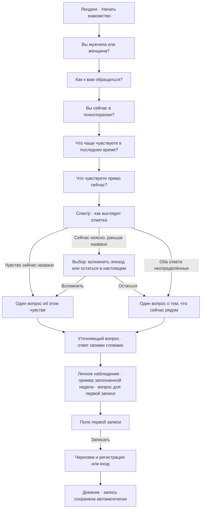

# Between · от первого вопроса до первой записи

Сценарий веб-анкеты. Все реплики в кавычках и в таблицах — текст, который увидит человек. Чтобы прочитать конкретный маршрут, выберите чувство в разделе 2, посмотрите принцип перехода в разделе 4 и перейдите к таблице этого чувства в разделе 5.

**Два быстрых маршрута:** [спокойно весь день](#calm-example) · [обычно тревожно, сейчас спокойно](#change-example)

## 1. Карта переходов

## 2. Общие экраны

| Экран | Вопрос или текст | Ответы и переход |
|---|---|---|
| Лендинг | «Начать знакомство» | Открыть вопрос о поле. «Войти» на лендинге ведёт прямо ко входу для тех, у кого есть дневник. |
| Пол | «Вы мужчина или женщина?» Подпись: «Так мы подберём формулировки в дневнике». | «Мужчина» / «Женщина» / «Предпочитаю не указывать». Один тап → экран имени. |
| Имя | «Как к вам обращаться?» | Поле имени → «Дальше». |
| Терапия | «Вы сейчас занимаетесь с психотерапевтом?» | «Да, регулярно» / «Только начинаю» / «Сейчас на паузе» / «Нет». Все идут дальше. Только первые два ответа дают повод позже предложить настройку сеансов. |
| В последнее время | «Какое чувство вы чаще замечаете в последнее время?» | Один вариант из списка ниже или «Не помню». Сразу перейти к следующему экрану. |
| Сейчас | «А если на секунду остановиться — что вы чувствуете прямо сейчас?» | Тот же список или «Пока не могу назвать». Сразу показать спектр. |

**Кнопки чувств на обоих экранах:** «Спокойствие» · «Радость» · «Тревога» · «Злость» · «Грусть» · «Усталость» · «Стыд» · «Ощущение пустоты» · «Напряжение».

У двух похожих экранов разные заметные заголовки: **«В последнее время»** и **«Прямо сейчас»**. На втором сверху виден предыдущий ответ, например «В последнее время — тревога». Ответ заранее не выбран. До регистрации можно вернуться назад и поменять выбор; зависимая от него карточка пересобирается.

### Как выбор влияет на текст

На следующем экране у всех один простой вопрос: «Как к вам обращаться?». После знакомства сохраняем обращение на «вы». Род становится заметен там, где сам человек выбирает реплику от первого лица, и в примерах дневниковых записей.

| Где | Мужчина | Женщина | Пол не указан |
|---|---|---|---|
| Ветка злости, вариант «Взять паузу» | «Я хотел сначала взять паузу» | «Я хотела сначала взять паузу» | «Хотелось сначала взять паузу» |
| Грусть, вариант про уединение | «Хочу побыть один» | «Хочу побыть одна» | «Хочу побыть наедине с собой» |
| Пример недели, вторник | «Целое утро свободно. Пока завтракал, отвечал в три чата. Самое суетливое утро за неделю». | «Целое утро свободно. Пока завтракала, отвечала в три чата. Самое суетливое утро за неделю». | «Целое утро свободно. Завтрак и сразу три чата. Самое суетливое утро за неделю». |
| Пример недели, среда | «До выхода десять минут. Налил ещё полчашки и дослушал его историю». | «До выхода десять минут. Налила ещё полчашки и дослушала его историю». | «До выхода десять минут. Ещё полчашки кофе, и можно дослушать его историю». |

Таблицы веток ниже задают смысл вариантов. При показе используем соответствующую фразу из этой таблицы. Фразы «Вы выбрали», «Что вам запомнилось?» и «Как вы себя чувствуете?» подходят всем. Сюжет примера, доступные чувства и вывод из ответов одинаковы. Имя не используется для определения пола. Если выбор пропущен или открыт старый черновик, показываем нейтральный текст. В английской версии естественные формулировки от первого и второго лица обычно совпадают.

## 3. Что показывает спектр

**Если чувство сейчас названо:** «Ваша первая отметка» → одна точка с фактическим местным временем и подписью чувства. Например: «Сегодня, 14:20 · спокойно». До регистрации это черновик, поэтому здесь ещё нет сообщения «Сохранено».

**Если чувство сейчас назвать трудно:** «Так выглядит спектр дневника» → только демонстрация. Пустой ответ не превращается в настроение «пусто». У ответа «Не помню» про последнее время тоже нет даты и точки на графике.

На этом экране показываем одну точку и подпись к ней. Если чувство неизвестно, точка подписана «Пример отметки». Пример того, что можно увидеть за целую неделю, появится на экране личного наблюдения (раздел 6).

Текст: «В какие моменты тревожно, даже если день прошёл спокойно? Сверяясь с записями, можно заметить, например, что в три таких вечера вы ждали ответа на важное сообщение.»

Кнопка **«Продолжить»** ведёт к вопросу для рефлексии.

## 4. Как два ответа определяют продолжение

| В последнее время | Сейчас | Что говорим перед уточнением | Куда дальше |
|---|---|---|---|
| Названо чувство | То же чувство | «Вы отметили [чувство] и сейчас, и когда вспоминали последнее время». | Таблица выбранного чувства. Одно совпадение не выдаём за ежедневную закономерность. |
| Названо чувство | Другое чувство | «В последнее время вы чаще замечаете [А]. Сейчас — [Б]. Давайте на минуту останемся здесь». | Таблица Б. Причину перемены не предполагаем. |
| «Не помню» | Названо чувство | «Сейчас вы заметили [Б]. Этого достаточно, чтобы начать». | Таблица Б. |
| Названо чувство | «Пока не могу назвать» | «В последнее время вы замечали [А]. К чему хочется обратиться?» | «Вспомнить один такой момент» → таблица А с подводкой «Вспомните один недавний момент с этим чувством. Ответьте о нём». Вопросы с «сейчас» показываем в прошедшем времени. «Остаться в настоящем» → нейтральная ветка ниже. |
| «Не помню» | «Пока не могу назвать» | «Можно начать с того, что вы замечаете вокруг». | Нейтральная ветка. |

Если человек вспоминает прошлое, карточка помечена **«Из недавнего»**. Она сохраняется как наблюдение. Текущее чувство и время задним числом не подставляем.

## 5. Ветки рефлексии

Человек выбирает ситуацию, видит уточняющий вопрос и отвечает своими словами. После этого Between показывает наблюдение с учётом ответа и отдельный вопрос для первой записи. У всех ситуаций есть вариант «По-другому». Уточнение в этом случае — «Какая деталь лучше всего передаёт ваш опыт?», вопрос для дневника — «Что об этом вам хочется запомнить?».

### Спокойно

**Какую часть этого дня вам хотелось бы взять с собой в завтра?**

| Ситуация | Уточнение внутри анкеты | Вопрос первой записи |
|---|---|---|
| Его темп | Когда сегодня вам удалось двигаться в своём темпе? | Для чего вам хочется оставить время завтра? |
| Время с кем-то | Что вы могли делать по-своему рядом с этим человеком? | Что хочется сказать этому человеку об этом моменте? |
| Время наедине | Что вам особенно понравилось делать в одиночестве? | Что в следующий раз хочется оставить только для себя? |
| День целиком | По какой мелочи вы бы узнали именно этот день? | Как рассказать об этом дне себе через год? |

### Радость

**Что вам хочется сделать с этой радостью?**

| Ситуация | Уточнение внутри анкеты | Вопрос первой записи |
|---|---|---|
| Рассказать кому-то | Какую часть этой истории вам особенно хочется рассказать? | С каких слов началось бы ваше сообщение? |
| Запомнить деталь | Что вы до сих пор видите или слышите, когда вспоминаете этот момент? | Чем вам дорога именно эта деталь? |
| Повторить | Что из этого вы могли бы устроить для себя ещё раз? | Что хочется попробовать в следующий раз? |
| Просто порадоваться | В какой момент вам стало особенно хорошо? | Как хочется назвать эту минуту? |

### Тревожно

**Если у этой тревоги есть тема, какая ближе?**

| Ситуация | Уточнение внутри анкеты | Вопрос первой записи |
|---|---|---|
| Жду решения или ответа | Что вам сейчас труднее всего в самом ожидании? | Что помогло бы вам прожить сегодняшний день, пока ответа нет? |
| Что-то предстоит | Когда вы представляете это событие, на каком моменте задерживаетесь? | Какая поддержка вам пригодилась бы в этот момент? |
| Возвращаюсь к случившемуся | Какой вопрос у вас остался после случившегося? | Когда вы вспоминаете эту ситуацию, какой момент первым приходит в голову? |
| Не вижу конкретной темы | Что вы делали, когда заметили тревогу? | Чего вам хочется в ближайшие несколько минут? |

### Злость

**Когда вы заметили злость, что вам захотелось сделать?**

| Ситуация | Уточнение внутри анкеты | Вопрос первой записи |
|---|---|---|
| Сказать, что меня задело | Какие слова или действия вас тогда задели? | Как бы вы сказали об этом своими словами? |
| Отказаться от чего-то | В какой момент вам захотелось сказать «нет»? | Что вам хотелось бы объяснить о своём отказе? |
| Взять паузу | Что происходило, когда вам впервые захотелось остановиться? | Как вы поймёте, что готовы к этому вернуться? |
| Пока ничего не делать | Что в этой ситуации всё-таки важно для вас, даже если вы решите ничего не делать? | О чём хочется помнить, если вы вернётесь к ситуации позже? |

### Грусть

**Что вам ближе в этот грустный момент?**

| Ситуация | Уточнение внутри анкеты | Вопрос первой записи |
|---|---|---|
| Хочется, чтобы выслушали | Что вам особенно хочется донести до человека, который вас выслушает? | Какого отклика вам хотелось бы? |
| Хочется побыть одному | Чего вам сейчас хочется от времени наедине с собой? | Как вам хотелось бы устроить это время для себя? |
| Хочется что-то вспомнить | Что из того воспоминания до сих пор трогает вас? | Какой фрагмент вам хочется сохранить в дневнике? |
| Пока не знаю, чего хочется | Как вы поняли, что вам грустно? | Что об этом дне вам хочется оставить здесь? |

### Усталость

**От чего сейчас особенно хочется отдохнуть?**

| Ситуация | Уточнение внутри анкеты | Вопрос первой записи |
|---|---|---|
| От решений | На каком выборе вы почувствовали, что сил уже мало? | С каким решением можно немного подождать? |
| От общения | В какой момент общения вам захотелось тишины? | Какая пауза между разговорами вам бы подошла? |
| От физической нагрузки | По чему вы поняли, что телу нужна передышка? | Какой отдых вам был бы приятен? |
| От всего понемногу | Когда за день вы впервые заметили, что сил стало меньше? | Что одно вам хотелось бы сегодня с себя снять? |

### Стыд

**Что сильнее занимает ваши мысли в этот момент?**

| Ситуация | Уточнение внутри анкеты | Вопрос первой записи |
|---|---|---|
| Что могли подумать другие | Что вы сами заметили в реакции окружающих? | Что в этой ситуации было известно только вам? |
| Что я говорю себе | Какая фраза прозвучала у вас в голове, когда стало стыдно? | Что бы вы сказали близкому человеку в такой ситуации? |
| Что хотелось бы исправить | Какой небольшой шаг с вашей стороны сейчас имел бы смысл? | Что для вас изменилось бы после этого шага? |
| Не хочется вдаваться в это | Что вам хочется сказать себе сейчас, оставив подробности за кадром? | Какое короткое название подойдёт этой записи? |

### Пусто

**Что вам сейчас легче всего заметить?**

| Ситуация | Уточнение внутри анкеты | Вопрос первой записи |
|---|---|---|
| Что происходит вокруг | Какой звук вы замечаете вокруг себя? | Какая деталь завтра напомнит вам, где вы были? |
| Что я делаю | Что вы делали прямо перед тем, как заметили пустоту? | Что об этой минуте хочется запомнить? |
| Чего хочется хотя бы немного | Что вам захотелось бы сделать в ближайшие пять минут? | С чего можно было бы начать? |
| Пока ничего | Каким словом вы бы подписали эту минуту? | Какими словами вы могли бы оставить след об этой минуте? |

### Напряжение

**По чему вы замечаете напряжение?**

| Ситуация | Уточнение внутри анкеты | Вопрос первой записи |
|---|---|---|
| По ощущениям в теле | Где в теле вы чувствуете это особенно отчётливо? | На что похоже это ощущение? |
| По мыслям | Как звучит мысль, по которой вы узнаёте напряжение? | Что происходило, когда появилась эта мысль? |
| По тому, как я действую | Что именно вы делаете иначе, когда напряжены? | Что в следующий раз хочется заметить чуть раньше? |
| Замечаю уже потом | Что помогло вам понять задним числом, что вы были напряжены? | Какую подсказку об этом моменте хочется оставить себе? |

### Если чувство трудно назвать

**Что из сегодняшнего дня легче всего вспомнить прямо сейчас?**

| Ситуация | Уточнение внутри анкеты | Вопрос первой записи |
|---|---|---|
| Разговор | Что из этого разговора вам хотелось бы обдумать ещё немного? | Что ещё вам хотелось бы сказать? |
| Одно занятие | Какая деталь помогла бы вам завтра вспомнить это занятие? | Что в этом занятии было для вас важно? |
| Место или деталь вокруг | Что именно притянуло ваш взгляд? | Как бы вы описали это тому, кого там не было? |
| Просто смотрю, как устроен дневник | Что из сегодняшнего дня вам было бы интересно перечитать через неделю? | С чего началась бы первая строка? |

## 6. От наблюдения до первой записи

Карточка связывает отметку сейчас, выбранную ситуацию и дословный ответ. Если привычное и текущее чувства различаются, видны обе отметки. Под финальным вопросом человек пишет первую запись. Кнопка «Записать» сохраняет черновик в текущей вкладке и открывает создание дневника или вход. Во время регистрации видны наблюдение, вопрос и текст записи.

После входа профиль получает имя и настройку терапии. Полная анкета хранится в дневнике. Только фактическая текущая отметка попадает на график, со временем её выбора. Сервис сохраняет текст как отдельную запись и открывает «Записи». При сбое черновик остаётся до подтверждения сохранения.

## 7. Примеры пути

**Спокойно весь день.** «День целиком» → «По какой мелочи вы бы узнали именно этот день?» → «Остывший кофе, потому что мы долго завтракали вместе». Вопрос первой записи — «Как рассказать об этом дне себе через год?».

**Обычно тревожно, сейчас спокойно.** «Его темп» → «Когда сегодня вам удалось двигаться в своём темпе?» → «По дороге домой вышла на остановку раньше». В наблюдении остаются обе отметки и эта деталь. Вопрос первой записи — «Для чего вам хочется оставить время завтра?».

## 8. Что сравнивать в воронке

Общие для всех чувств шаги: вопрос о поле → имя → терапия → показ вопроса о последнем времени → показ вопроса «сейчас» → просмотр спектра → выбор детали → свой ответ на уточнение → экран наблюдения и ввод первой записи → нажатие «Записать» → завершение регистрации или входа → автоматическое сохранение. Целевое действие — первая сохранённая запись своими словами. Для сравнения шагов достаточно названия экрана и действия.

## 9. Практики, на которых основаны вопросы

Для тревоги, стыда, злости и напряжения используем приём из дневника мыслей КПТ. Берём конкретную ситуацию и спрашиваем о чём-то одном — мысли, чувстве или действии. Если человек тревожится в ожидании, у него можно спросить, о чём он думает, пока ждёт. Если стыдится чужой оценки, можно предложить вспомнить реакцию, которую он сам видел или слышал. [NHS, Thought record](https://www.nhs.uk/every-mind-matters/mental-wellbeing-tips/self-help-cbt-techniques/thought-record/)

Для радости и спокойствия берём из практики Three Good Things внимание к подробностям приятного события. Смысл первой записи может быть в том, чтобы сохранить конкретную минуту или заметить, что хочется повторить. [UC Berkeley, Three Good Things](https://ggia.berkeley.edu/practice/three-good-things)

Когда чувство трудно назвать, один из доступных входов — обратить внимание на тело, своё действие или то, что сейчас вокруг. Этот подход опирается на практику заземления. Все формулировки написаны для Between как приглашения к записи. У этой подборки нет диагностической шкалы. [ВОЗ, Doing What Matters in Times of Stress](https://www.who.int/publications/i/item/9789240003927)
